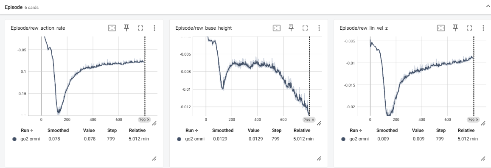

# 自然言語で操る四足歩行ロボット（Genesis × 強化学習 × LLM）

Physical AI 応用編1 講座 最終課題

「左に90度曲がって」「カニ歩きで左に移動して」といった日本語の指示で、四足歩行ロボット Unitree Go2 をシミュレータ上で動かします。

- **低レベル制御**：強化学習（PPO）で学習した全方向歩行の方策が、速度コマンドどおりに歩く
- **高レベル計画**：Colab の GPU 上で動かすオープン LLM（Qwen2.5-7B-Instruct）が、日本語の指示を速度コマンドの列に変換する

デモ動画：（YouTube の URL をここに記載）

```
日本語の指示 ──▶ LLM（Qwen2.5-7B）──▶ 速度コマンド列 ──▶ 安全チェック ──▶ RL 方策（PPO）──▶ Go2（Genesis）
                  JSON で出力        vx, vy, wz, 秒数    左右の矛盾補正・範囲クリップ   12関節の目標角度
```

---

## 実行手順

Google Colab で、ノートブックを上から順に実行するだけで再現できます。

1. `PAI_final_go2_llm.ipynb` を Colab で開く
2. 「ランタイム」→「ランタイムのタイプを変更」→ **A100 GPU**（T4 の場合は下記「T4 で動かす場合」を参照）
3. セル 2 の `SAVE_DIR` を、自分の Google Drive の保存先に書き換える
4. 「ランタイム」→「すべてのセルを実行」

| セル | 内容 | 所要時間の目安（A100） |
|---|---|---|
| 0 | GPU の確認 | — |
| 1 | Genesis・rsl-rl・transformers のインストール | 5〜10 分 |
| 2 | Drive の接続、共通設定 | — |
| 3 | 学習スクリプトの生成（コマンド範囲の拡張） | — |
| 4 | 強化学習（800 イテレーション、4096 並列環境）。Drive に学習済みモデルがあれば自動でスキップ | 初回コンパイル数分＋学習 |
| 5 | 録画スクリプトの生成 | — |
| 6 | 手動プランでの動作確認（約 15 秒の動画） | 数分 |
| 7 | LLM の読み込みと、指示 → コマンド列の変換関数 | 初回ダウンロード数分 |
| 8 | 本番の指示からプランを作り、字幕付きの mp4 を出力 | 数分〜十数分 |

### 学習済みモデルで推論だけ動かす（学習をスキップ）
このリポジトリの `logs/go2-omni/`（`cfgs.pkl` と `model_799.pt`）を使うと、強化学習をせずに推論だけで動かせます。

**ノートブックで動かす場合**
1. `logs/go2-omni/` フォルダを、Google Drive の `SAVE_DIR/logs/` の下にコピーする（`SAVE_DIR/logs/go2-omni/model_799.pt` となるように）
2. ノートブックを上から実行する。セル 4 で「Drive の学習済みモデルを使います（学習はスキップ）」と表示され、学習が飛ばされる
3. セル 8 の `INSTRUCTIONS` を好きな日本語の指示に書き換えると、LLM がそれをコマンド列に変換し、学習済みの方策が実行する

**コマンドラインで動かす場合**（セル 1 のインストール後）
```bash
cd /content/Genesis/examples/locomotion
cp -r <このリポジトリ>/logs/go2-omni logs/
cp <このリポジトリ>/record_go2.py <このリポジトリ>/plan.json .
python record_go2.py -e go2-omni --plan plan.json --out demo.mp4
```
`plan.json` はデモ動画で使った速度コマンド列（LLM の出力を保存したもの）です。これを使えば、LLM なしでデモ動画と同じ動きを再現できます。秒数や速度を手で書き換えて、自分のプランを作ることもできます。

推論に使っている AI は次の 2 つです。
- **強化学習で学習した方策**（`model_799.pt`）：観測（姿勢、関節角度、速度コマンドなど）から、12 関節の目標角度を 50 Hz で出力する
- **LLM**（Qwen2.5-7B-Instruct）：日本語の指示から、速度コマンド列を生成する

### T4 で動かす場合
- セル 4：`ITER = 300` に下げる
- セル 7：`LOCAL_MODEL = "Qwen/Qwen2.5-3B-Instruct"` に変更する（7B は T4 のメモリに収まらない）

### 動作確認した環境
- Google Colab（NVIDIA A100-SXM4-40GB）、Python 3.13
- PyTorch 2.11.0+cu130
- genesis-world（バージョン：`pip show genesis-world` の値をここに記載）
- rsl-rl-lib >= 5.0.0
- LLM：Qwen/Qwen2.5-7B-Instruct

---

## ファイル構成

```
.
├── README.md
├── PAI_final_go2_llm.ipynb   # 全体の実行ノートブック（自作）
├── my_go2_train.py           # 公式 go2_train.py を改造した学習スクリプト
├── record_go2.py             # 録画スクリプト（自作）
├── plan.json                 # デモ動画で使った速度コマンド列（LLM の出力）
├── LICENSE-Genesis           # Genesis のライセンス本文（Apache License 2.0）
└── logs/go2-omni/
    ├── cfgs.pkl              # 学習時の設定
    └── model_799.pt          # 学習済みの方策
```

`go2_env.py`（環境定義）は Genesis 公式リポジトリのものをそのまま使っているため、このリポジトリには含めていません。ノートブックのセル 1 で自動的に取得されます。

---

## 元にしたもの と 自分で改造・追加した部分

### 公式サンプルをそのまま使用している部分
出典：[Genesis-Embodied-AI/Genesis](https://github.com/Genesis-Embodied-AI/Genesis) の `examples/locomotion/`（Apache License 2.0）

| 対象 | 内容 |
|---|---|
| `go2_env.py` | Go2 の強化学習環境（観測、報酬関数、終了条件、PD 制御） |
| `go2_train.py` の学習設定 | PPO のハイパーパラメータ、ネットワーク構成、報酬の重み |
| rsl-rl | PPO の実装（`OnPolicyRunner`） |
| Go2 のモデル | Genesis 同梱の URDF |

### 改造した部分
| 対象 | 公式の状態 | 改造後 |
|---|---|---|
| `go2_train.py` → `my_go2_train.py` | 速度コマンドが「前進 0.5 m/s」で固定。前に歩くことしか学習しない | 前後 −0.5〜1.0 m/s、横 −0.4〜0.4 m/s、旋回 −1.0〜1.0 rad/s の範囲でランダムに与えて学習。**前後・横・旋回の全方向歩行**ができる方策にした |
| 学習時間 | 101 イテレーション | 全方向歩行は前進だけより難しいため、800 イテレーションに増やした |

### 自分で追加した部分
**1. LLM による行動計画（ノートブック セル 7）**
- 日本語の指示を、速度コマンド（`vx`, `vy`, `wz`, `duration`）の JSON 配列に変換するプロンプトを設計した。速度の意味と範囲、「左回りは wz が正」などのルール、旋回時間の目安を記述している
- 外部 API に頼らず、オープン LLM（Qwen2.5-7B-Instruct）を Colab の GPU 上で動かす構成にした
- 回答例（few-shot）として、右旋回・左旋回・カニ歩き・ジグザグの例を与えた
- LLM の返答から JSON 部分だけを取り出し、値を数値に整える処理を入れた。秒数は 0.5〜10 秒に制限する
- 出力が壊れた場合は、キーワードによる簡易ルールに自動で切り替えるようにした
- `LLM_BACKEND = "rule"` にすると、LLM を使わない簡易ルールだけで動かせる（LLM 版との比較用）

**2. LLM 出力の安全チェック（`fix_direction`）**
- 動作の説明（caption）にある「左／右」と、速度の符号が矛盾している場合に自動で補正する
- 学習した範囲を超えるコマンドは、方策が対応できないため範囲内にクリップする（`record_go2.py`）

**3. 録画スクリプト（`record_go2.py`）**
- 公式の評価スクリプトはビューアの表示が前提で、Colab では動かないため、画面なしで mp4 に出力するスクリプトを新たに作った
- `Go2Env` は内部でシーンを構築するため、構築の直前にカメラを差し込む仕組みにした
- ランダムなコマンドの再抽選を止め、プランどおりのコマンドだけで動かすようにした
- 録画中にタイムアウトでリセットされないよう、エピソード長を延ばした
- ロボットを追いかけるカメラ（揺れを抑える平滑化つき）を付けた
- 指示、現在の動作、速度コマンド、経過時間を日本語の字幕として重ねた

**4. Colab で動かすための対応（ノートブック全体）**
- Colab に最初から入っている TensorFlow が学習時に一緒に読み込まれ、Genesis のコンパイラとぶつかって `free(): invalid pointer` で異常終了する問題を見つけ、TensorFlow を削除して回避した
- Genesis のバージョンによる引数名の違い（`--num_envs` / `--num-envs` など）や、`rsl-rl-lib` の必要バージョンをスクリプトから自動で判定するようにした
- 学習結果を Google Drive に保存し、セッションが切れても学習をやり直さずに続きから使えるようにした

---

## 学習データ

外部から集めたデータセットは使っていません。

| AI | 学習データ | 今回やったこと |
|---|---|---|
| 歩行の方策（`model_799.pt`） | シミュレーションで自分で集めた経験（約 7,900 万ステップ） | ゼロから学習 |
| LLM（Qwen2.5-7B-Instruct） | 開発元による事前学習データ（非公開） | 推論のみ。プロンプトと回答例で振る舞いを調整 |

### 歩行の方策：シミュレーションで集めた経験
強化学習では、ロボットがシミュレータの中で試行錯誤した経験そのものが学習データになります。

1. 4096 台の Go2 を Genesis の中で同時に歩かせる
2. 1 台ずつランダムな速度コマンドを与える（前後 −0.5〜1.0 m/s、横 −0.4〜0.4 m/s、旋回 −1.0〜1.0 rad/s）
3. 各ロボットが「観測 → 関節の目標角度を出す → 報酬を受け取る」を繰り返す
   - 観測：機体の傾きと回転速度、関節の角度と速度、速度コマンド、前回の出力
   - 報酬：コマンドどおりの速度で歩けたか、高さや姿勢が乱れていないか、動きが滑らかか
4. 集めた経験で PPO により方策を更新する。ここまでを 1 イテレーションとして 800 回繰り返す

公式設定では 1 イテレーションで 1 台あたり 24 ステップの経験を集めるため、全体の量は次のとおりです。

**4096 台 × 24 ステップ × 800 回 ≒ 約 7,900 万ステップ**

1 ステップは 0.02 秒なので、ロボット 1 台で歩くと約 18 日分に相当します。これを A100 上で約 5 分で集めました。

### LLM：事前学習済みモデルを推論で使用
- Qwen2.5-7B-Instruct は、開発元（Alibaba の Qwen チーム）が大量のテキストで事前学習したモデルです。学習データの詳細は公開されていません
- 今回はモデルの重みを一切変更せず、推論だけに使っています
- 振る舞いは、プロンプト（速度の意味と範囲、左右のルール）と 3 つの回答例（few-shot）で調整しました。例を見せてその場で真似させる使い方で、追加学習（ファインチューニング）はしていません

---

## 結果

800 イテレーションの学習で全方向歩行の方策ができ、9 個の日本語の指示から合計 63.8 秒のデモを実行できました。

### 強化学習

- 設定：PPO、4096 環境を並列に実行、800 イテレーション（NVIDIA A100 40GB）
- 学習時間：約 5 分（TensorBoard の記録で 5.0 分）
- 学習済みモデル：`logs/go2-omni/model_799.pt`（100 イテレーションごとに保存したうちの最終版）


<!-- TensorBoard の Train/mean_reward のスクリーンショットを images/learning_curve.png として保存すると表示されます -->

#### ペナルティ項の推移



| 項目 | 意味 | 800 イテレーション時点の値 |
|---|---|---|
| `rew_action_rate` | 関節の指令の急な変化 | −0.078 |
| `rew_base_height` | 機体の高さの目標（0.3 m）からのずれ | −0.0129 |
| `rew_lin_vel_z` | 上下方向の揺れ | −0.009 |

- **3 つとも 100〜150 イテレーション付近で最も悪化し、その後に回復した。** 最初はほとんど動かないためペナルティが小さく、歩き始めると動きが荒れて一度悪化する。その後、滑らかに歩けるようになって改善した
- **動きの滑らかさ（`rew_action_rate`）と上下の揺れ（`rew_lin_vel_z`）は、最後まで改善を続けた**
- **高さのずれ（`rew_base_height`）だけは、400 イテレーション以降に再び悪化した。** 速度の追従を優先する中で、機体の高さを保つことを犠牲にしている可能性がある。重みを上げるか、学習を延ばすかが今後の課題

### LLM による指示の変換

最初に使った Qwen2.5-3B（回答例は右旋回の 1 つだけ）では、左右や動作の種類を取り違えました。Qwen2.5-7B への変更と、ルールと回答例の追加で、9 個の指示すべてを安全チェックの補正なしで正しく変換できました。

| 指示 | Qwen2.5-3B（回答例 1 つ） | Qwen2.5-7B（ルールと回答例を追加） |
|---|---|---|
| 左に 90 度曲がって | × wz=−1.00（右回り） | ○ wz=+1.00 |
| その場で左に一回転して | × wz=−1.00（右回り） | ○ wz=+1.00、6.3 秒 |
| カニ歩きで左に 4 秒 | × vx=+0.40（前進） | ○ vy=+0.30 |
| カニ歩きで右に 4 秒戻って | × vx=−0.40（後退） | ○ vy=−0.30 |
| ジグザグに 10 秒前進 | × まっすぐ前進のみ | ○ wz=±0.80 を 4 回切り替え |
| 前に歩きながらゆっくり左に曲がって | × wz=−0.50（右回り） | ○ wz=+0.50 |
| 右に 90 度曲がって | ○ wz=−1.00 | ○ wz=−1.00 |

### うまくいった点
- 前後・横・旋回の速度コマンドを、1 つの方策で切り替えながら歩けた
- 外部 API を使わずに、日本語の指示から動作の計画までを Colab の GPU 上だけで完結できた
- 7B モデルとルール・回答例の組み合わせで、左右の符号や動作の種類を正しく扱えた

### うまくいかなかった点・課題
- **秒数の指定が守られないことがある**：「右回りの円を 10 秒」が 6.3 秒になり、円は半周程度になった
- **角度は時間で決めているだけ**：LLM は「90 度 ≈ 1.6 秒」という目安で時間を決めるため、方策が指令どおりの旋回速度を出せないと実際の角度はずれる。ロボットの向きを測って計画し直す仕組みはない
- **小さいモデルは左右を取り違える**：3B では上の表のような誤りが出た。安全チェック（`fix_direction`）で補正はできるが、動作の説明（caption）まで間違えた場合は直せない
- **平地のみ**：学習も実行も平らな地面だけで行った

---

## ライセンス・クレジット

- `my_go2_train.py` は Genesis 公式の `examples/locomotion/go2_train.py`（Apache License 2.0）を改変したもの。改変内容はファイル先頭に記載。ライセンス本文は `LICENSE-Genesis` を参照
- 実行時に使用：[Genesis](https://github.com/Genesis-Embodied-AI/Genesis)、[rsl-rl](https://github.com/leggedrobotics/rsl_rl)、[Qwen2.5-7B-Instruct](https://huggingface.co/Qwen/Qwen2.5-7B-Instruct)
